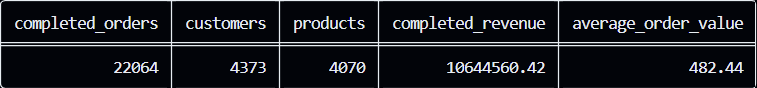
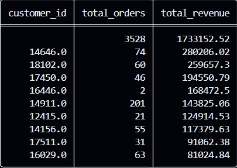
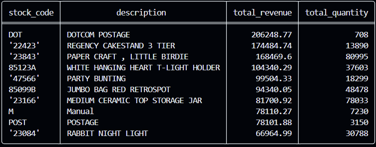
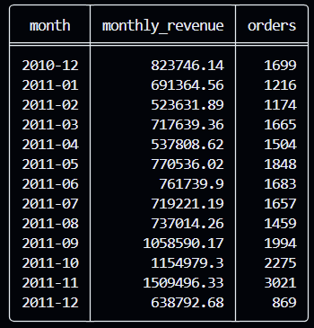
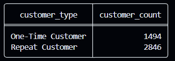

# 📊 SQL Sales Analysis

**An end-to-end retail sales data analysis project using SQL and SQLite.**

This project analyzes the UCI Online Retail dataset to uncover business insights related to sales performance, customer purchasing behavior, product revenue, monthly trends, customer retention, and international sales.

The goal is to demonstrate practical SQL skills, data cleaning, exploratory analysis, business intelligence, and the ability to translate raw retail transaction data into actionable insights.

---

## 📌 Project Overview

The project uses a retail transaction dataset containing over 500,000 records. SQL queries are used to clean the data, calculate key performance indicators, identify trends, and answer business questions.

**Tools and technologies**
- **SQL** — data cleaning, aggregation, joins, filtering, and business analysis
- **SQLite** — relational database management and query execution
- **Excel / CSV** — data inspection and preparation
- **Git and GitHub** — version control and project documentation

## 📈 Key Results

The following results are from the project's existing analysis.

| Metric | Result |
|---|---:|
| Transaction rows | 541,909 |
| Unique customers with recorded IDs | 4,373 |
| Unique products | 4,070 |
| Completed orders | 22,064 |
| Completed-order revenue | £10,644,560.42 |
| Average order value (AOV) | £482.44 |
| Cancelled invoices | 3,836 |
| Revenue from cancelled invoices | -£896,812.49 |

### Key Business Findings

- **Geographic performance:** The United Kingdom generated the highest revenue in the country-level analysis.
- **Monthly performance:** November 2011 was the strongest month by completed-order revenue.
- **Customer retention:** Repeat customers represented approximately 65.6% of identified customers with completed-order activity.
- **Data quality:** The dataset contains missing customer IDs and cancellation transactions that require careful handling.
- **Product performance:** Product-level revenue analysis identifies leading revenue contributors and helps distinguish ordinary products from service-related entries.

> **Metric definitions:** Completed-order revenue excludes invoices marked as cancellations. Average order value is based on completed orders, not individual transaction lines. Customer retention figures include identified customers with completed-order activity. Country-level analysis excludes records without an identified customer ID, so its totals may differ from the overall sales analysis.

---

## 🎯 Business Questions

This project explores the following questions:

1. What are the overall sales KPIs and revenue trends?
2. How many orders, customers, and products are represented in the dataset?
3. Which customers generate the most revenue?
4. Which products contribute the most revenue?
5. How does revenue change over time?
6. What proportion of customers make repeat purchases?
7. What data-quality issues exist in the raw transaction data?
8. How do sales and order values differ across countries?
9. How do cancellations affect the interpretation of sales performance?
10. What actionable business insights can be derived from the analysis?

---

## 📂 Dataset

The project uses the **UCI Online Retail dataset**, which contains transactions from a UK-based online retailer.

### Dataset Columns

| Column | Description |
|---|---|
| `InvoiceNo` | Invoice number identifying a transaction; cancellation invoices typically begin with `C` |
| `StockCode` | Product code |
| `Description` | Product description |
| `Quantity` | Number of units in the transaction line |
| `InvoiceDate` | Date and time of the transaction |
| `UnitPrice` | Price per unit in pounds sterling |
| `CustomerID` | Customer identifier, when available |
| `Country` | Customer's country |

The dataset contains 541,909 transaction rows. Some records have missing customer IDs or descriptions, and cancellation transactions require special treatment during analysis.

**Data availability:** The raw dataset and generated SQLite database are excluded from this GitHub repository. You must obtain the dataset separately and prepare the CSV file described in the setup instructions below.

---

## 🔄 Project Workflow

```text
Raw Retail Dataset
        |
        v
CSV Data Preparation
        |
        v
SQLite Database Setup
        |
        v
Data Cleaning and Validation
        |
        v
Exploratory SQL Analysis
        |
        v
Customer, Product and Time Analysis
        |
        v
Retention and Country Analysis
        |
        v
Business Insights
```

---

## 🗂️ Project Structure

```text
SQL-Sales-Analysis/
│
├── data/
│   └── sales_data.csv              # Local dataset; not tracked by Git
│
├── database/
│   └── sales_analysis.db           # Generated database; not tracked by Git
│
├── sql/
│   ├── 01_database_setup.sql        # Database creation and data preparation
│   ├── 02_basic_analysis.sql        # Overall sales KPIs
│   ├── 03_customer_analysis.sql     # Customer-level analysis
│   ├── 04_product_analysis.sql      # Product performance analysis
│   ├── 05_time_analysis.sql         # Monthly and time-based trends
│   ├── 06_advanced_analysis.sql     # Advanced SQL analysis
│   ├── 07_business_insights.sql     # Business-focused findings
│   ├── 08_data_quality_checks.sql   # Data-quality validation
│   ├── 09_customer_retention.sql    # Repeat purchasing and retention
│   └── 10_country_sales_analysis.sql # Country-level sales analysis
│
├── screenshots/
│   ├── executive_kpis.png
│   ├── top_customers.png
│   ├── top_products_revenue.png
│   ├── monthly_revenue.png
│   └── customer_segments.png
│
├── DATA_DICTIONARY.md               # Column definitions and data notes
├── README.md
└── .gitignore
```

*Note: The `data/` and `database/` directories may not appear in a fresh clone until you create them locally. The CSV and database files are intentionally excluded from version control.*

---

## 🧹 Data Preparation and Quality

The database setup and analysis scripts prepare the data for meaningful analysis.

Key considerations include:

- Calculating line-level revenue using `Quantity × UnitPrice`.
- Identifying missing customer IDs and product descriptions.
- Distinguishing completed invoices from cancellation invoices.
- Checking for records that could affect revenue calculations.
- Applying consistent filtering when comparing customer, product, time, and country results.

The project includes a dedicated data-quality module to make these checks explicit rather than assuming the raw dataset is clean.

---

## 🧠 SQL Skills Demonstrated

The project demonstrates practical use of:

- `SELECT`, `WHERE`, `ORDER BY`, and `GROUP BY`
- Aggregate functions such as `SUM`, `AVG`, `COUNT`, `MIN`, and `MAX`
- Conditional aggregation and `CASE WHEN`
- `COUNT(DISTINCT ...)`
- Common table expressions (CTEs)
- Date-based grouping and monthly trend analysis
- Customer segmentation and repeat-purchase analysis
- Revenue calculations and business KPIs
- Data-quality checks and missing-value handling
- Multi-step analytical queries
- Country-level comparisons and ranking

---

## ▶️ How to Run

Follow these steps to run the project locally or in GitHub Codespaces.

### 1. Clone the repository

```bash
git clone https://github.com/Ayushkr604/SQL-Sales-Analysis.git
cd SQL-Sales-Analysis
```

If you are already working inside the repository in Codespaces, you can skip this step.

### 2. Install SQLite

Make sure SQLite is installed and available in your terminal.

Check the installation:

```bash
sqlite3 --version
```

### 3. Prepare the dataset

Create the required local directories:

```bash
mkdir -p data database
```

Download the UCI Online Retail dataset and prepare a CSV file named:

```text
data/sales_data.csv
```

The setup script expects this exact path and filename. If you download the original Excel file, convert it to CSV first and ensure the column names match those used by the SQL setup script.

**Important:** The raw dataset is not included in this repository. The database setup will not work until the CSV is in the expected location.

### 4. Create the database and prepare the tables

Run the following command from the repository root:

```bash
sqlite3 database/sales_analysis.db ".read sql/01_database_setup.sql"
```

This runs the database setup script, which imports the CSV data and prepares the `sales_raw` and `sales_clean` tables.

### 5. Run the analysis scripts

Run each script from the repository root:

```bash
sqlite3 database/sales_analysis.db ".read sql/02_basic_analysis.sql"
sqlite3 database/sales_analysis.db ".read sql/03_customer_analysis.sql"
sqlite3 database/sales_analysis.db ".read sql/04_product_analysis.sql"
sqlite3 database/sales_analysis.db ".read sql/05_time_analysis.sql"
sqlite3 database/sales_analysis.db ".read sql/06_advanced_analysis.sql"
sqlite3 database/sales_analysis.db ".read sql/07_business_insights.sql"
sqlite3 database/sales_analysis.db ".read sql/08_data_quality_checks.sql"
sqlite3 database/sales_analysis.db ".read sql/09_customer_retention.sql"
sqlite3 database/sales_analysis.db ".read sql/10_country_sales_analysis.sql"
```

Each command executes its SQL file and displays the query results in the terminal.

**Tip:** Run the scripts individually when exploring the results. This makes it easier to understand each query and its business purpose.

### 6. Explore the database interactively

Open the SQLite database:

```bash
sqlite3 database/sales_analysis.db
```

List the tables:

```sql
.tables
```

Inspect the cleaned data:

```sql
SELECT *
FROM sales_clean
LIMIT 10;
```

Exit SQLite:

```sql
.quit
```

---

## 📊 Analysis Modules

| File | Focus |
|---|---|
| `01_database_setup.sql` | Database creation, CSV import, and preparation of analysis tables |
| `02_basic_analysis.sql` | Overall sales KPIs and transaction summaries |
| `03_customer_analysis.sql` | Customer-level performance and spending |
| `04_product_analysis.sql` | Product revenue and sales performance |
| `05_time_analysis.sql` | Monthly revenue and time-based trends |
| `06_advanced_analysis.sql` | Advanced analytical queries |
| `07_business_insights.sql` | Business-focused findings |
| `08_data_quality_checks.sql` | Missing values and data-quality checks |
| `09_customer_retention.sql` | Repeat customers and retention analysis |
| `10_country_sales_analysis.sql` | Revenue and order comparisons by country |

---

## 📷 Project Screenshots

The following screenshots showcase key results from the SQL analysis.

### 1. Executive Sales KPIs



### 2. Top Customers by Revenue



### 3. Top Products by Revenue



### 4. Monthly Revenue Trends



### 5. Customer Segmentation



---

## 🔐 Data and Privacy

The repository does not intentionally include the local raw CSV files, Excel dataset, or generated SQLite database.

The `.gitignore` file excludes:

```gitignore
data/*.csv
data/*.xlsx
database/*.db
```

This keeps large local data files out of version control and allows the SQL analysis to be shared independently of the dataset.

---

## 🚀 Future Improvements

Potential next steps for the project include:

- Building an interactive Power BI dashboard
- Adding visualizations for monthly revenue and customer retention
- Creating a more detailed executive summary of business recommendations
- Adding automated validation for query outputs
- Improving the reproducibility of data preparation
- Expanding the analysis with customer cohorts and product-category insights

---

## 👨‍💻 Author

**Ayush Kumar**

Computer Science undergraduate at BITS Pilani, Pilani Campus.

Interested in data analytics, SQL, business intelligence, and data-driven problem solving.

- **GitHub:** [Ayushkr604](https://github.com/Ayushkr604)
- **Project Repository:** [SQL Sales Analysis](https://github.com/Ayushkr604/SQL-Sales-Analysis)

---
